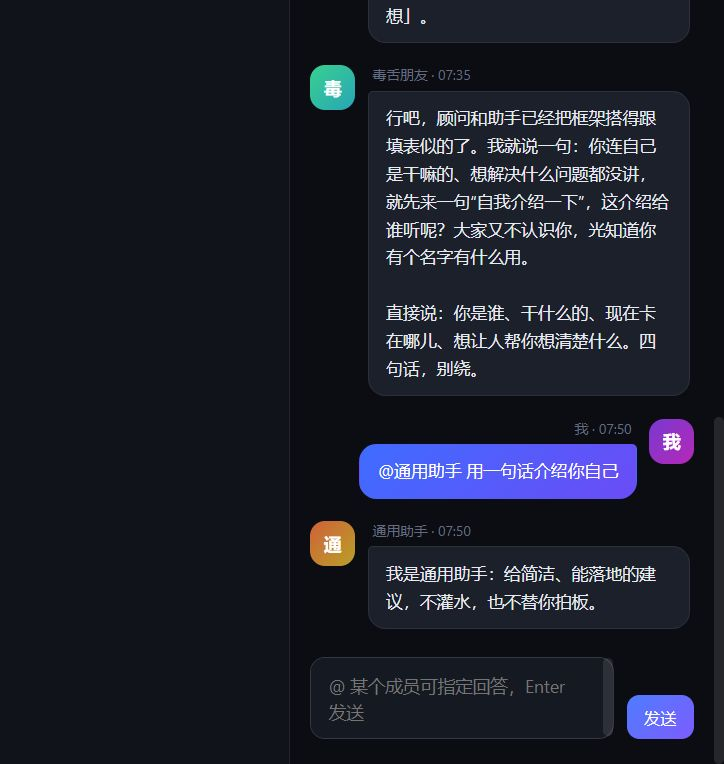

# AIDiscussion

和一群 AI 成员一起群聊、私聊的桌面聊天工作台。

群里的成员是各家 AI：可以随时添加、踢除；也可以单独私聊某个 AI。
群聊支持 @ 点名、自由讨论和主持人调度，私聊与群聊共用同一套会话与消息模型。

> 项目正在按章节迭代，当前进度：**第 10 章 · 文档与发布（v0.1.0）**。



## 技术栈

| 层 | 选型 |
| --- | --- |
| 语言 | Python 3.12（uv 管理） |
| 配置 | pydantic-settings |
| 存储 | SQLAlchemy 2.0（异步）+ SQLite |
| 模型 | httpx + OpenAI 兼容协议（流式 SSE） |
| 服务 | FastAPI + WebSocket |
| 桌面 | pywebview（可选） |
| 交付 | Docker · GitHub Actions |

## 快速开始

```bash
uv sync
cp .env.example .env      # 填入 AIDISCUSSION_LLM_API_KEY
uv run aidiscussion --check
uv run aidiscussion --ask "你好"   # 流式试聊，未配置密钥时使用离线 Mock
uv run aidiscussion --chat          # 进入交互式群聊
uv run aidiscussion --serve         # 启动 Web 服务（http://127.0.0.1:8000）
uv sync --extra desktop             # 安装桌面外壳依赖（可选）
uv run aidiscussion --desktop       # 桌面悬浮球模式
```

打开 <http://127.0.0.1:8000> 即可使用 Web 界面：左侧切换会话与私聊 AI，右侧聊天区支持流式回复、@ 点名、切换群聊模式和成员增删，无需安装任何前端依赖。

## Web 界面

- 纯原生 HTML / CSS / JS，由 FastAPI `StaticFiles` 直接托管，构建流程为零
- WebSocket 流式渲染：`reply_start` 建气泡、`reply_delta` 逐字追加、`reply_done` 定稿
- 三种群聊模式（点名 / 自由讨论 / 主持人调度）按会话记忆在 `localStorage`
- 当前会话、断线重连、成员管理与新建群聊都在同一页面完成

## 桌面悬浮球

`uv run aidiscussion --desktop` 会启动一个内置服务并打开 84×84 的圆形悬浮球（置顶、可拖动）：

- 左键点击：展开完整聊天窗口
- 关闭聊天窗口：缩回悬浮球，程序继续在后台运行
- 右键悬浮球：退出

### 像普通软件一样启动（Windows）

第一次先安装桌面依赖：

```bash
uv sync --extra desktop
```

然后创建桌面快捷方式，之后双击桌面上的 **AIDiscussion** 图标即可，不会出现终端黑框：

```powershell
powershell -ExecutionPolicy Bypass -File scripts\install-shortcut.ps1
```

希望登录 Windows 后自动悬浮，加上 `-Startup`：

```powershell
powershell -ExecutionPolicy Bypass -File scripts\install-shortcut.ps1 -Startup
```

关闭聊天窗口只会缩回悬浮球；要彻底退出请右键悬浮球。若更新了代码，需要右键退出后重新打开。

桌面壳基于 pywebview，仅是 Web UI 的外壳，数据和服务与浏览器版完全一致。
Windows 需要 WebView2 运行时（Win10/11 通常已自带）；pywebview 属于可选依赖，
未安装时 `--desktop` 会提示执行 `uv sync --extra desktop`，不影响 `--serve`。

## 容器化与 CI

```bash
docker build -t aidiscussion .
docker run --rm -p 8000:8000 --env-file .env -v aidiscussion-data:/data aidiscussion

# 或者
docker compose up --build
```

镜像内以 `AIDISCUSSION_API_HOST=0.0.0.0` 启动服务，SQLite 数据落在 `/data` 卷；
`.github/workflows/ci.yml` 在 Ubuntu / Windows 上跑 ruff + pytest，并校验 Docker 构建。

## 项目结构

```text
src/aidiscussion/
├── api/            # FastAPI 应用、REST、WebSocket
├── cli/            # 终端聊天客户端
├── db/             # 模型与异步数据库
├── desktop/        # pywebview 悬浮球外壳
├── llm/            # OpenAI 兼容适配层与 Mock
├── repositories/   # 数据访问
├── services/       # 编排、上下文、压缩、记忆
└── web/            # 原生前端
```

更完整的分层、数据模型与消息时序见 [架构说明](docs/ARCHITECTURE.md)。

## 文档

- [架构说明](docs/ARCHITECTURE.md)
- [贡献指南](CONTRIBUTING.md)
- [更新日志](CHANGELOG.md)

## 上下文压缩与长期记忆

聊得越久，历史消息越多，直接把全部记录塞给模型既慢又贵。这里的处理是：

- **滑动窗口**：最近 `context_keep_recent` 条消息始终原样保留
- **增量摘要**：超出 `context_max_tokens` 的更早消息由模型压缩，并与旧摘要合并；
  摘要记录 `up_to_message_id`，下一轮只处理新增部分，不会重复压缩
- **硬截断兜底**：压缩失败或使用离线 Mock 时，直接丢弃最旧消息，聊天不中断
- **长期记忆**：足够长的用户消息会触发一次轻量提取，产出关于用户的事实/偏好并落库；
  后续按中文二元组 + 英文关键词重合度召回，注入 system prompt。
  记忆跨会话共享，群聊里记下的事私聊也能用；终端里可用 `/memory` 查看

相关配置见 `.env.example`：`AIDISCUSSION_CONTEXT_MAX_TOKENS`、
`AIDISCUSSION_CONTEXT_KEEP_RECENT`、`AIDISCUSSION_MEMORY_ENABLED`、`AIDISCUSSION_MEMORY_TOP_K`。

## 接口

REST（`/api`）：

| 方法 | 路径 | 说明 |
| --- | --- | --- |
| GET | `/health` | 健康检查 |
| GET | `/me` | 当前用户 |
| GET / POST | `/members` | 成员列表 / 新建 AI 成员 |
| PATCH / DELETE | `/members/{id}` | 修改人设 / 停用成员 |
| GET / POST | `/conversations` | 会话列表 / 新建群聊 |
| POST | `/conversations/direct` | 打开或复用与某个 AI 的私聊 |
| GET | `/conversations/{id}` | 会话详情（含成员与最后一条消息） |
| GET | `/conversations/{id}/messages` | 历史消息（支持 `limit`、`before_id`） |
| POST / DELETE | `/conversations/{id}/members` | 拉人 / 踢人 |

WebSocket `ws://127.0.0.1:8000/ws/conversations/{id}`：

```json
{"type": "send", "content": "@行业顾问 这单怎么谈", "mode": "mention"}
```

服务端依次推送 `user_message`、`reply_start`、多个 `reply_delta`、`reply_done`，失败时推送 `reply_failed`。

## 开发

```bash
uv run pytest        # 测试
uv run ruff check .  # 静态检查
```

## 路线图

- [x] 第 1 章 工程骨架与配置
- [x] 第 2 章 领域模型与持久化
- [x] 第 3 章 LLM 适配层与流式输出
- [x] 第 4 章 会话编排（私聊 / @ / 自由讨论 / 主持人）
- [x] 第 5 章 终端客户端
- [x] 第 6 章 FastAPI + WebSocket 服务层
- [x] 第 7 章 Web 聊天界面
- [x] 第 8 章 上下文压缩与长期记忆
- [x] 第 9 章 桌面悬浮球与容器化
- [x] 第 10 章 文档与发布

## 发布

版本号维护在 `pyproject.toml`，发布流程由 `.github/workflows/release.yml` 自动完成：
先跑 ruff 与测试，再执行 `uv build` 构建 wheel / sdist，最后创建 GitHub Release。

```bash
git tag v0.1.0
git push origin v0.1.0
```

## 许可

[MIT](LICENSE)
