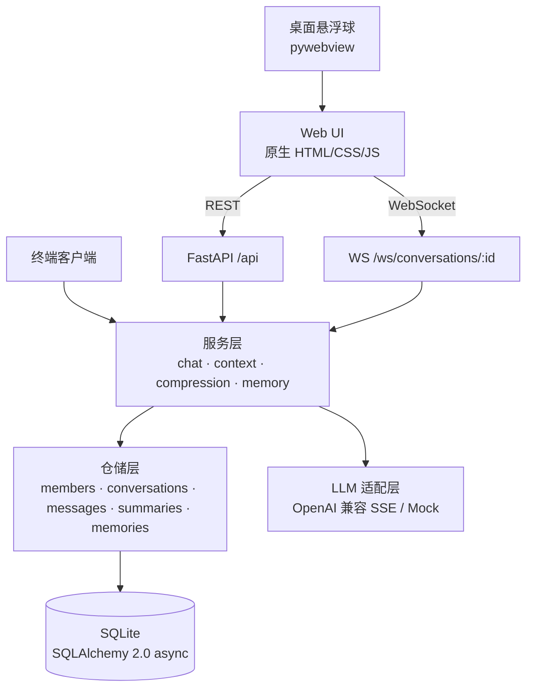
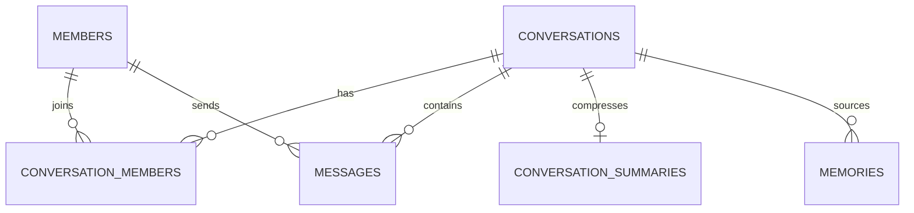
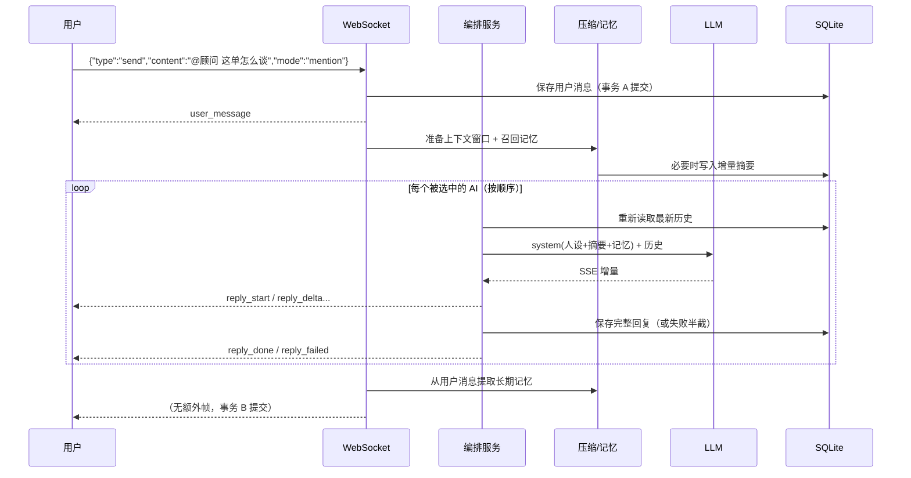

# 架构说明

AIDiscussion 是一个「多 AI 群聊工作台」。它没有把群聊做成特殊功能，而是把
**群聊、私聊、@ 点名、自由讨论** 统一到同一条消息链路上，再在其上叠加模型编排、
上下文压缩与长期记忆。

## 分层



| 层 | 职责 | 位置 |
| --- | --- | --- |
| 入口 | 终端、Web 服务、桌面壳 | `cli/`、`api/`、`desktop/` |
| 服务 | 会话编排、上下文组装、压缩、记忆 | `services/` |
| 仓储 | 数据访问，只 flush 不 commit | `repositories/` |
| 模型 | SQLAlchemy 表结构与枚举 | `db/` |
| 模型接入 | 流式调用、错误映射、重试、离线降级 | `llm/` |
| 配置 | pydantic-settings，`AIDISCUSSION_` 前缀 | `config.py` |

## 数据模型



- `members`：你和每个 AI 都是同一种实体，只靠 `kind` 区分
- `conversations.type`：`group` / `direct`；私聊就是只有两个成员的 direct 会话
- `messages`：所有消息统一存储，踢人后历史消息仍然保留
- `conversation_summaries`：`up_to_message_id` 之前的消息已被摘要覆盖
- `memories`：跨会话共享的长期记忆，来源会话删除后仍保留

## 一次群聊消息的时序



关键点：

1. **先落库再生成**：用户消息先独立提交，模型失败也不会丢消息
2. **每个成员重新读历史**：同一轮里后发言的 AI 能看到前面成员刚说的话
3. **回复失败保留半截**：标记为 `failed`，前端可提示中断原因
4. **记忆提取在回复之后**：失败只记日志，不影响聊天

## 群聊调度模式

| 模式 | 行为 |
| --- | --- |
| `mention` | 只有被 `@` 的 AI 发言；没点名则静默 |
| `free` | 群内所有 AI 依次发言，受 `max_replies` 轮次上限约束 |
| `supervisor` | 先让模型挑一个最合适的发言人，再生成回复 |

私聊不参与调度：无论什么模式，都只由那个 AI 回复。

## 上下文与记忆

- 最近 `context_keep_recent` 条消息原样保留
- 超出 `context_max_tokens` 的更早消息压缩成摘要，`up_to_message_id` 保证不重复压缩
- 压缩失败或离线 Mock 时退回硬截断
- 长期记忆用中文二元组 + 英文词重合度召回，不引入向量库

## 关键取舍

| 决策 | 原因 |
| --- | --- |
| 群聊/私聊共用一套表与消息链路 | 避免两套逻辑分叉，私聊天然复用全部能力 |
| 仓储只 flush，事务收在 `Database.session()` | 「建会话 + 加成员 + 写消息」可以原子提交 |
| httpx 直连 OpenAI 兼容协议 | 不绑定某家 SDK，换供应商只改配置 |
| 前端零构建 | 克隆即可运行，专注后端编排；后续可平滑替换为 React |
| 记忆用关键词而非向量 | 个人工作台数据量小，可解释、可测试、零额外依赖 |

## 目录速览

```text
src/aidiscussion/
├── api/            # FastAPI 应用、REST、WebSocket、DTO
├── cli/            # 终端聊天客户端
├── db/             # Base、模型、异步引擎
├── desktop/        # pywebview 悬浮球与后台服务线程
├── llm/            # LLM 协议、OpenAI 兼容实现、Mock、错误
├── repositories/   # 数据访问
├── services/       # 编排、上下文、压缩、记忆、令牌估算
└── web/            # 原生前端（由 StaticFiles 托管）
```

## 后续可扩展点

- 把 `free` / `supervisor` 调度替换为 LangGraph 状态机，加入发言意图与终止条件
- 摘要与记忆改为后台任务，避免阻塞回复首帧
- 前端替换为组件化框架时，REST 与 WebSocket 协议保持不变
